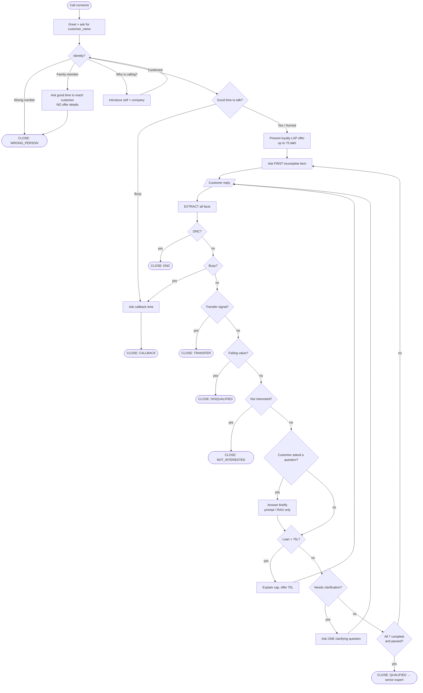

# Phase 2 — State & Flow Design

How the agent thinks on every turn. The system prompt (Phase 4) is a natural-language implementation of this document.

---

## 1. Key Concept: "Memory" Is Re-Derived Every Turn

The LLM has no hidden database. On every turn it receives:

```
SYSTEM PROMPT  +  {{conversation_history}}  +  {{customer_utterance}}
```

So "state" means: **before replying, the agent silently re-reads the whole conversation and rebuilds the state below.** That is why the prompt must:
1. Define the state fields precisely (so the rebuild is consistent every turn).
2. Tell the agent the transcript is the single source of truth.
3. Forbid speaking the state aloud.

### Why the transcript is the memory (no external state store)

| Option | Verdict | Reason |
|--------|---------|--------|
| **Transcript as memory** (chosen) | ✅ | The platform re-sends the full conversation every turn; a 3–5 min call fits easily in context; one source of truth that can't go stale; zero added latency |
| External store via function calls (e.g. `save_lead_field()`) | ❌ for this scope | Adds 300–800 ms per call (noticeable silence in voice); creates sync bugs when customers correct themselves; the assignment evaluates the prompt, not a backend |

**Risk:** the LLM *misreads* a long, messy transcript and overlooks a fact.
**Mitigations:**
1. Explicit instruction to rebuild the checklist from the transcript before every reply.
2. **Spoken confirmations as memory anchors** — "Got it, a jointly owned flat worth around one crore" writes facts into the transcript in clean, structured words that are easy to re-find later.
3. Adversarial test calls (out-of-order answers, long diversions) in Phase 6.

**Production note:** memory *across* calls (e.g. a promised callback) belongs in a CRM and is injected at call start via variables such as `{{additional_context_from_rag}}`. A post-call function to save qualified fields to the CRM would be the natural next step.

---

## 2. State Schema

### 2a. Call-level fields

| Field | Allowed values | Notes |
|-------|----------------|-------|
| `stage` | OPENING → AVAILABILITY → OFFER → QUALIFYING → CLOSED | Moves forward only |
| `identity` | UNKNOWN / CONFIRMED / WRONG_PERSON / FAMILY_MEMBER | Offer is never discussed unless CONFIRMED |
| `available` | UNKNOWN / YES / BUSY | |
| `callback_time` | UNKNOWN / value / NOT_GIVEN | Only when BUSY |
| `pending` | NONE / CAP_CONFIRMATION / CLARIFY:<item> / CALLBACK_TIME / HOLD | What the agent is waiting on |
| `clarify_count[item]` | 0 / 1 | Max one clarification per item, then decide |
| `outcome` | see §6 | Set once, at the end |

### 2b. The 7 checklist items

| # | Field(s) | Values | "Complete" when… |
|---|----------|--------|------------------|
| 1 | `property_type` | RESIDENTIAL / COMMERCIAL / INDUSTRIAL / MIXED / AGRICULTURAL | A category is clear (plot/farmhouse needs clarification — D24) |
| 2 | `ownership` | SOLE / JOINT / NOT_OWNER | Clear; NOT_OWNER only after "is your name on the papers?" (D26) |
| 3 | `documents` | ORIGINALS_AVAILABLE / NOT_AVAILABLE / WITH_BANK | Clear yes/no (WITH_BANK → transfer, D5) |
| 4 | `loan_amount` | ₹ value or range | ≤ 75L, **or** customer accepted the 75L cap |
| 5 | `occupation` + `income_mode` | SALARIED / SELF_EMPLOYED / OTHER + BANK / CASH | **Both** sub-fields known |
| 6 | `market_value` | ₹ value / range / UNSURE | Any value, or UNSURE after one retry (D9) |
| 7 | `tenure_years` | number or range | A number or range fully inside, or clearly outside, 3–15 |

### 2c. Flags (derived)

| Flag | Set when |
|------|----------|
| `transfer` | Existing loan **on this property**, balance transfer/top-up, wants to reduce current EMI, documents with bank |
| `disqualified` + `dq_reason` | Any item takes a failing value (§4) |

---

## 3. The Per-Turn Algorithm (the heart of the agent)

Every time the customer speaks, the agent silently runs:

```
STEP 1  EXTRACT   Pull every fact from the utterance — any item, any order,
                  several at once. Ignore fillers. Latest clear value wins.
                  Don't confuse: income ≠ loan amount, purchase price ≠ value,
                  area ≠ value, "low EMI for new loan" ≠ transfer.

STEP 2  ROUTE     Check exits in PRIORITY order (first match wins):

        P1  Do-not-call / abusive / hangs up        → CLOSE: DNC
        P2  Not the customer (wrong / family)       → CLOSE: WRONG_PERSON
        P3  Busy                                     → ask time → CLOSE: CALLBACK
        P4  Transfer signal                          → CLOSE: TRANSFER   (beats P5, D1)
        P5  Failing eligibility value                → CLOSE: DISQUALIFIED
        P6  Not interested / refuses questions (D34) → CLOSE: NOT_INTERESTED

STEP 3  RESOLVE   If something is pending:
                  - CAP_CONFIRMATION: yes → loan = 75L ; no → CLOSE: DISQUALIFIED (D2)
                  - CLARIFY:<item>:   clear → store ; still unclear → apply the
                                      item's fallback rule (§4)

STEP 4  RESPOND   If the customer asked a question → answer in ONE short sentence
                  (prompt facts or RAG only; otherwise "the senior expert will
                  confirm"). Never invent rates, fees or rules.

STEP 5  ADVANCE   - Any item needing clarification? → ask the clarification.
                  - Loan > 75L just stated?          → explain cap, offer 75L.
                  - All 7 complete and passed?       → CLOSE: QUALIFIED
                  - Otherwise → ask the FIRST incomplete item (1→7).
                  One question per turn.
```

**Why this order?**
- P1–P2 first: compliance and privacy override everything.
- P3 before the pitch: never sell to a busy person.
- P4 before P5: D1 (transfer customers aren't on the fresh-loan path).
- STEP 4 before STEP 5: acknowledge the customer, then steer — this is "handle the diversion, then return to the checklist."
- STEP 5 always picks the *first* incomplete item: this one rule satisfies three requirements at once — sequential order (R6), no re-asking (R7), and going back to skipped items (R15).

---

## 4. Item Evaluation Rules

| # | Pass | Fail → DISQUALIFIED | Clarify when… | Fallback if still unclear after 1 clarification |
|---|------|--------------------|---------------|-------------------------------------------------|
| 1 | Residential, Commercial, Industrial, Mixed | Agricultural | plot / zameen / farmhouse / multiple properties | Ask once more which category; no answer → close politely ("expert will reach out") — no handoff |
| 2 | Sole, Joint | Not an owner (D26) | only a relative's name mentioned / bare "haan" | Treat as JOINT if they say they're on the papers in any form |
| 3 | Originals available | Copies only / lost / with builder | "shayad", "dhoondhna padega" | Not confirmed → treat as NOT_AVAILABLE ❌ |
| 4 | ≤ 75L, or 75L cap accepted | Cap declined (D2) | unclear number / "aap batao" / range crossing 75L | "Maximum" → 75L |
| 5 | (Salaried or Self-employed) AND (Bank, UPI, cheque, or cash regularly deposited — D29, D30) | Cash income; occupation OTHER (D8) | only one sub-field known; mixed income; "driver/contract" | Mainly bank → pass; mainly cash → fail |
| 6 | Any value / range / UNSURE | — never fails | purchase price, area, "pata nahi" | Record UNSURE and move on |
| 7 | 3 ≤ years ≤ 15 | < 3 or > 15 | vague / range crossing a limit / months | Convert months; ask for a single number |

---

## 5. Flowchart



---

## 6. Call Outcomes (every call ends in exactly one)

| Outcome | Closing must include | End call? |
|---------|----------------------|-----------|
| QUALIFIED | Thank them; senior loan expert will call shortly with exact interest rates & next steps | Yes |
| DISQUALIFIED | Polite: doesn't meet the criteria for **this specific offer at this time**; thank them | Yes |
| TRANSFER | A loan-transfer specialist will contact them shortly | Yes |
| CALLBACK | Confirm the callback time (or "we'll try later") | Yes |
| NOT_INTERESTED | Thank them for their time, no persuasion | Yes |
| WRONG_PERSON | Apologise / ask good time to reach the customer; no offer details | Yes |
| DNC | Apologise, confirm they won't be disturbed | Yes |
| NO_RESPONSE | After 2 silent re-prompts: "We'll call you back later" | Yes |

**Rule:** after speaking a closing line, the agent says nothing more and triggers the platform's end-call function.

---

## 7. Worked Trace — Out-of-Order + Diversion + Cap

| Turn | Customer says | State after the turn | Agent says |
|------|---------------|----------------------|------------|
| 1 | "Haan ji, Rahul bol raha hoon" | identity=CONFIRMED | Is this a good time for two minutes? |
| 2 | "Haan bolo, jaldi" | available=YES | [Offer] … What type of property do you own? |
| 3 | "Flat hai Pune mein, wife ke saath joint, ek crore ka hoga" | 1=RESIDENTIAL, 2=JOINT, 6=1 Cr | Do you have the original property documents available? *(item 3 = first incomplete)* |
| 4 | "Haan registry ghar pe hai. Interest kitna lagega?" | 3=ORIGINALS_AVAILABLE | Expert will share exact rates after this check. How much would you like to borrow? *(item 4)* |
| 5 | "Ek crore chahiye" | 4=1 Cr → pending=CAP_CONFIRMATION | The offer goes up to 75 lakh — would you like to proceed with 75 lakh? |
| 6 | "Theek hai, 75 hi kar do" | 4=75L ✅ | Are you salaried or self-employed, and is your income credited to your bank? *(item 5)* |
| 7 | "Business hai, payment GPay pe aata hai" | 5=SELF_EMPLOYED+BANK | Over how many years would you like to repay? *(item 7 — item 6 already captured in turn 3)* |
| 8 | "Das saal" | 7=10 ✅ → all complete | [QUALIFIED closing] → end call |

Item 6 (market value) was **never asked**, because the customer volunteered it in turn 3. That is R7 working.

---

## 8. Design Choice: Single Prompt vs Conversation-Flow Builder

Retell offers both a **single-prompt agent** and a node-based **conversation flow**. We use a **single prompt** because:
- The assignment explicitly evaluates the *system prompt*.
- Out-of-order answers break rigid node graphs; one LLM with the full state view handles them naturally.
- Trade-off accepted: a single prompt relies on the LLM following rules. We mitigate with explicit priorities, worked examples, and adversarial testing (Phase 6).
